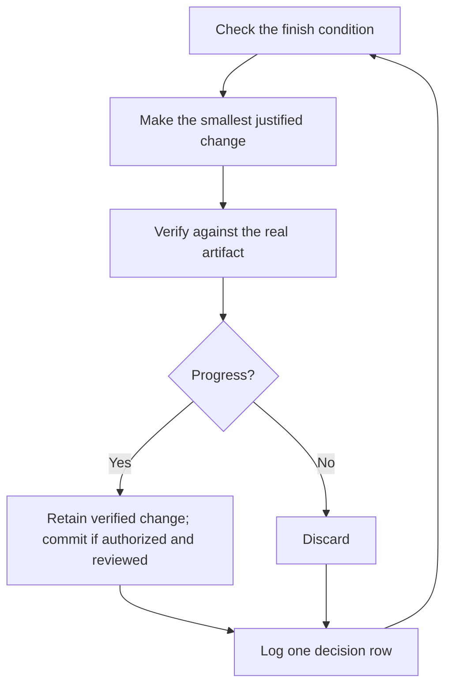

# Run work while you sleep
## Session capabilities and ownership

These prompts name pstack workflows, not guaranteed host commands. Read [session capabilities](../../references/host-capabilities.md), [model roles](../../references/model-roles.md), [assignment and action contracts](../../references/orchestration-contract.md), and [workflow ownership](../../references/workflow-ownership.md) before acting. Keep the active controller. An explicit pstack invocation owns its workflow; an active Superpowers assignment remains with Superpowers. An unqualified request retains the active owner. If both are requested, resolve ownership first.

Full behavior requires observed authorized tools for every required operation. Ordinary ChatGPT with supplied source but no execution can explain and prepare drafts; runnable verification is blocked. Worker-enabled ChatGPT and local Codex must discover and observe actual tools separately. Without independent workers, sequential role work is reduced capability and cannot satisfy independent review. Unknown actual models remain unknown. Missing history, persistence, execution, app control or GitHub access blocks dependent steps. A diagram is an illustration, never evidence that a tool exists. See the [host matrix](../testing/host-matrix.md).

Reading these files directly does not prove supported plugin loading, registration, invocation or host behavior. Both hosts remain not-run. Installation, dependency setup, host enabling, personal settings, schedules, credentials, listeners, commits and external writes retain their applicable explicit permission gates. A local draft is not a PR or verified app. Read the linked adapted workflow in full before its step; a missing required companion remains a blocked gate.


This is the payoff for everything before it. An agent you can trust to verify its own work is an agent you can leave alone with a hard task. What makes that safe isn't hope. It's a checkable finish condition, an authorized isolated worktree or observed remote worker, and a decision log you audit in the morning.


## Earn the trust before the loop

A loop you don't trust just produces unchecked work faster, and the mess compounds with every iteration. Before you leave one running, check that it has earned it:

- You've done the task once by hand, or watched an agent do it, so you know what good looks like.
- The agent has the tools and signals you'd use yourself: the verification skill, the profiler, the logs.
- Every stage proves its work and can stop the line when the work misses the bar.
- You've read a few transcripts and turned the repeated failures into tools, skills, or checks.

Make the loop autonomous only after all four hold. Until then, run it while you watch.

## The overnight contract

A good handoff has the goal, the finish condition, permissions, and an escape hatch. It doesn't need to be long:

```text
/poteto-mode im going to bed. migrate every caller to the new parser in a fresh worktree off <base>.
done means zero old callers, all parser fixtures pass, old api deleted.
keep a decision log. don't ask me before committing.
use an authorized exposed wake mechanism until done. if you're truly stuck after a few hours, stop and write up why.
```

Walk through what each line buys you:

- "im going to bed" requests continued work within existing permissions. It does not authorize setup, commits, external writes or scheduling.
- "done means..." turns the goal into checks every iteration can run.
- "fresh worktree off `<base>`" keeps the run from colliding with anything else you have open.
- "don't ask me before committing" pre-answers the permission the agent would otherwise block on.
- The source alias `/loop` names its host wake command, not a bundled pstack skill or portable binding. A wake mechanism must be exposed, explicitly authorized and observed registered before claiming it active. Without persistent wake, continue useful current-turn work as reduced capability and save a continuation brief; promise no work after the turn.
- The escape hatch lets it stop at a genuine dead end and write up why, which beats eight hours of creative goal reinterpretation.

Because you'll review this work after stepping away, `/poteto-mode` routes it through [`/figure-it-out`](../../skills/figure-it-out/SKILL.md), which designs the run's phases before any code and wires in the decision log.

To stop a run on purpose, tell the agent to pause, or that you're about to go offline or restart the host. The [Pause safely playbook](../../skills/poteto-mode/playbooks/pause-safely.md) finishes or backs out of the current step, prepares a durable checkpoint, committing only when authorization and review gates permit it, and writes a resume note. A fresh chat picks the work up from that note through the Session pickup playbook. Saying "keep going" never triggers a pause.

## What the loop does all night



One change, one check, one log row, every iteration. Discard only this run's owned changes that did not help. A plateau means pivot, not stop, and the finish condition never quietly relaxes to declare victory. Read the [Autonomous run contract](../../skills/poteto-mode/playbooks/autonomous-run.md) for the continuation brief and exact pending-action recovery rules.

## The morning audit

[`/show-me-your-work`](../../skills/show-me-your-work/SKILL.md) makes the run reviewable. Its [log helper](../../skills/show-me-your-work/scripts/log.sh) takes exactly `<logfile> <phase> <decision> <why> <evidence> <result>` through authorized execution. The logfile must be an explicit owned path. It rejects tabs, newlines and carriage returns before writes and quotes formula-leading cells. The [template](../../skills/show-me-your-work/references/decision-log-template.tsv) records time, phase, decision, reason, evidence and result. Use `decisions.tsv` or an owned `.audit/<task-slug>.tsv`, append without rewriting history, and read back the result. Retain the accessible-transcript audit, cross-model review and Attention requirements. Missing history or independent review remains explicit. Commit the trail only when separately authorized and reviewed. A saved trail proves neither unattended execution nor recovery.

When you're back, ask for the run in review form:

```text
/show-me-your-work catch me up on what you did last night
```

With observed authorized worker support, the skill spawns a reviewer on a different observed model family to read the trail and the transcript, and the reply ends with an Attention section listing what deserves your scrutiny. Read that section first, then the log rows it points at. You're auditing decisions, not re-reading the whole night.

For a quick status instead of an audit, run [`/ketchup`](../../skills/ketchup/SKILL.md) in the chat that ran the work. It reads only, and tells you in plain words what changed since your last message, with the screenshots and small diagrams the work produced. Then it lists each call waiting on you, such as a merge, an approval, or a choice between options, with its pick, the evidence, and the risk, so you can decide from the reply alone.

## When the night holds a queue, not a task

The contract above drives one task to one finish condition. Some nights hold more, a queue of independent changes or a whole program. Three playbooks scale the same trust up.

[Autopilot-full](../../skills/poteto-mode/playbooks/autopilot-full.md) runs a queue of independent PRs to merged. Each PR gets one owner agent that carries it from build through merge, and no owner merges on its own verdict. A swarm of fresh verifiers starts a round at the owner's code-ready head and again at every later push that changes the patch. This port retains its stricter operative re-verification contract; the upstream guide's reduced cadence is not adopted. Only a clean verdict on the patch that merges authorizes the merge:

```text
/poteto-mode full autopilot on this queue. each item is independent. i want them merged by morning.
```

[Autopilot-stack](../../skills/poteto-mode/playbooks/autopilot-stack.md) runs the same owner loop but ships nothing. You wake up to one linear base-branch stack with a verifier's verdict on every link, and you review and land it yourself. Pick it over Autopilot-full when the changes are coupled, or when you want your own eyes on the work before anything merges:

```text
/poteto-mode autopilot these five changes but stack them, don't ship. i'll land the stack in the morning.
```

[Orchestrate](../../skills/poteto-mode/playbooks/orchestrate.md) is for a program that outlives any single agent: multi-day, many stacked PRs, fleets of subagents under one standing coordinator chat. The coordinator authors briefs, collects what its subagents finish, keeps the lowest unmerged PR green, and never writes code itself. It's deliberately heavy machinery. If one agent could finish the work in a session, the playbook itself routes you back to the overnight contract above:

```text
/poteto-mode orchestrate the store migration. own it until every package is converted and merged. i'll check in twice a day.
```

## Run many projects in parallel

A standing program needs observed workers, isolated ownership, execution, persistence, result inspection and wake control. A coordinator directs rather than writes code. Remote placement does not prove work continues when the computer closes. Without persistent wake, retain an authorized read-back continuation brief and report foreground reduced capability.

A few habits help:

- Give each body of work its own program, such as a feature, a migration, a perf push, or a tech-debt cleanup. Several can run side by side.
- Relay authorized related chats and completed artifacts through observed history or explicit brief attachments. Confirm each worker can read them; a coordinator's history is not automatically worker context.
- Give each PR a verification swarm before it merges, and let Autopilot-stack or Autopilot-full carry the queue.
- Ask the coordinator for a plan backed by data, and have it answer open questions with prototypes before it asks you.

One prompt can carry a whole program, from research through execution:

```text
/poteto-mode refactor this repo so its architecture is more agent friendly. use /correct and /architect on past commits and review comments to find the mistakes agents make most here. use /recall for context from past chats. answer open questions with prototypes instead of asking me. come back with a plan backed by real data. once i approve it, run it with autopilot-stack or autopilot-full, and ask me which.
```

## Let loops start themselves

Every loop above still waits for you to start it. A scheduled or event-driven automation removes that step. Software maintenance splits into stages that suit this well: triage a report, reproduce it, fix it, verify the fix. Two rules keep such a line trustworthy:

- Every stage can stop the line. Triage can decide the report is expected behavior, repro can fail to reproduce it, and the fixer can judge the change too risky. Each of those outcomes is useful, because it keeps bad work from reaching the next stage, where it costs more to undo.
- Every stage hands over evidence. Repro attaches screenshots and video of the broken state, and the fix attaches before-and-after proof. A human can then check that the agent fixed the right thing before reading a line of code.

pstack ships this as a dormant [automation pack](../../automations/benny/README.md) for Slack issue reports. One automation triages each report. The other reproduces confirmed bugs and may prepare a small draft fix. Read its [`FOR_AGENTS.md`](../../automations/benny/FOR_AGENTS.md) and name the target repository when requesting a setup proposal. Slack integrations, schedules, credentials, messages and deployment remain disabled until separately authorized and observed.

**Pitfall:** a duration is not a finish condition. "work on this for 4 hours" gives the agent nothing to check, and you'll wake up to four hours of motion instead of a result. Give `the observed wake mechanism` a predicate that can pass or fail.

Next: [Steer with principle names](./08-principles.md).

Illustrations retain the canonical source bytes and alt text. Attribution: Copyright (c) 2026 Lauren Tan, MIT, from cursor/plugins pstack 0.15.15 at df581122cde17e6e27686b5a448bde23e4ad4318. See [license](../../LICENSE) and [lineage](../../UPSTREAM.md). The pictured workers, logs and controls are illustrative.
